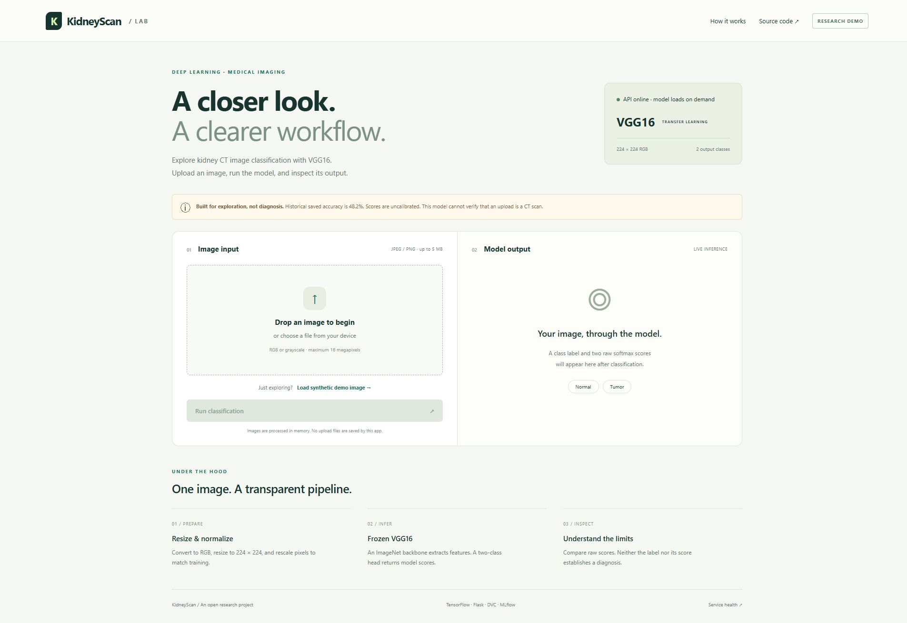
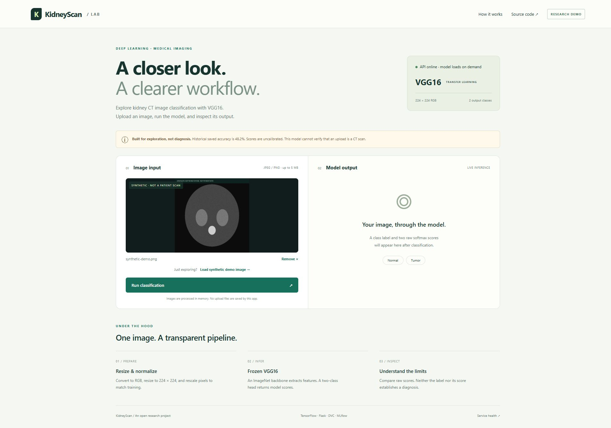
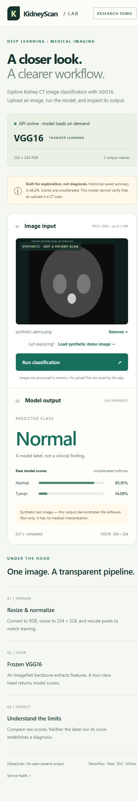
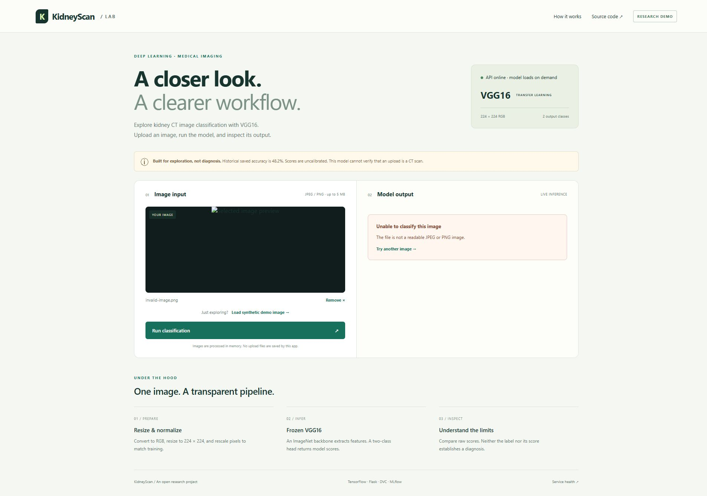
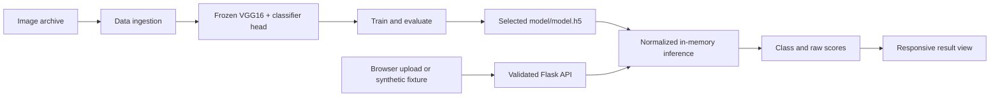

# DL · Kidney CT Classification


**An end-to-end deep learning research demo: upload an image, run the bundled VGG16 classifier, and inspect Normal / Tumor model scores.**

   

The repository name follows **project type + project name**: `DL-Kidney-CT-Classification`. It contains a TensorFlow transfer-learning pipeline, a Flask API served with Waitress, a responsive browser interface, DVC stages, and optional MLflow integration.

> **Research demo, not a clinical product.** Historical saved accuracy is **48.20%**. The model is not clinically validated, cannot verify that an image is a CT scan, and must not inform medical decisions. Working software does not establish model quality.

## Project showcases

The following are screenshots from the actual local application. The sample is a generated software fixture, clearly marked **synthetic**, and contains no patient data. Its class label has no medical interpretation.

### 1 · Desktop workspace



### 2 · Image preview



### 3 · Live model output


### 4 · Mobile layout



### 5 · Validation and recovery



See the [demo guide](docs/DEMO.md) and [verification evidence](docs/VERIFICATION.md) for commands, scope, results, and limitations.

## Run the demo

Use **Python 3.11** for the serving environment. Run commands from the repository root.

```bash
git clone https://github.com/vams2krish/DL-Kidney-CT-Classification.git
cd DL-Kidney-CT-Classification
python -m venv .venv
```

Activate it:

```powershell
# Windows PowerShell
.\.venv\Scripts\Activate.ps1
```

```bash
# macOS / Linux
source .venv/bin/activate
```

Install the serving dependencies and start Waitress:

```bash
pip install -r requirements-demo.txt
python serve.py
```

Open **http://127.0.0.1:8080**, choose **Load synthetic demo image**, and click **Run classification**. No dataset download, tracking account, cloud API key, or retraining is needed for this walkthrough. The first prediction loads the bundled model; subsequent predictions reuse it.

The default server binds to loopback. `HOST` and `PORT` can configure the listening address for a controlled deployment. A public deployment additionally needs TLS, authentication or access controls, rate limiting, monitoring, and an appropriate data policy. This repository does not provision a public inference service.

## What the demo implements

- A responsive upload, preview, loading, result, error, and reset workflow without external fonts or scripts.
- JPEG / PNG validation, a **5 MB decoded image** limit, **8 MB request** limit, and **16 megapixel** limit.
- In-memory image handling; the app does not save uploaded files or log their image payloads.
- EXIF orientation correction, RGB conversion, bilinear resizing to 224 × 224, and `1/255` normalization.
- Real softmax scores from the bundled model, explicitly labeled **uncalibrated**. No fabricated confidence percentages.
- Serialized model loading and execution across concurrent requests, without shared upload filenames.
- Health and model-readiness endpoints, structured API errors, same-origin requests, and security response headers.
- A Waitress entry point, non-root Docker configuration, and automated API / real-model tests.

These are software hardening steps for a research demonstration. They do not make the classifier clinically ready or establish public-service security under load.

## Architecture



| Area | Implementation |
| --- | --- |
| Project type | Deep learning, supervised binary image classification |
| Backbone | ImageNet VGG16 with the original classifier removed and backbone frozen |
| Head | Flatten → Dense(2, softmax) |
| Training | SGD, categorical cross-entropy, augmentation, 30% directory validation split |
| Serving runtime | Python 3.11, TensorFlow 2.15.0, Flask 3.1.2, Waitress 3.0.2 |
| Training runtime | Original `requirements.txt` pins TensorFlow 2.12.0 and MLflow 2.2.2; use a separate environment |
| Pipeline | Four DVC stages or `python main.py` |
| Tracking | MLflow logging implementation, disabled in the evaluation entry point by default |

```text
app.py / serve.py                 Flask application factory / WSGI entry point
static/                           Local CSS, JavaScript, and synthetic demo fixture
templates/index.html              Responsive browser interface
model/model.h5                    Bundled serving model
src/cnnClassifer/
  components/                     Ingestion, base model, training, evaluation
  pipeline/                       Stage entry points and in-memory prediction
  config/                         Configuration manager
  entity/                         Configuration classes
  utils/                          Original training utilities
config/config.yaml                Dataset URL and artifact locations
params.yaml                       Training configuration
dvc.yaml / dvc.lock                Pipeline definition and recorded state
scores.json                       Historical evaluation metrics
requirements-demo.txt             Pinned direct serving dependencies
requirements-dev.txt              Serving dependencies plus pytest
requirements.txt                  Original training dependencies
research/                         Development notebooks
tests/test_app.py                 API, validation, preprocessing, real-model tests
tools/generate_demo_fixture.py    Deterministic synthetic fixture generator
docs/showcase/                    Screenshots from the running product
.github/workflows/                Demo checks and manual AWS template
```

`cnnClassifer` retains the existing import-directory spelling.

## API

| Method | Route | Response |
| --- | --- | --- |
| GET | `/` | Browser interface |
| GET | `/health` | Liveness and current model-loaded status |
| GET | `/ready` | Load/check the model; 200 if ready, 503 if unavailable |
| POST | `/predict` | Base64 JPEG/PNG input; class and raw scores |
| GET / POST | `/train` | 403; run training locally instead |

```python
import base64
import json
from pathlib import Path
from urllib.request import Request, urlopen

encoded = base64.b64encode(Path('static/synthetic-demo.png').read_bytes()).decode()
request = Request(
    'http://127.0.0.1:8080/predict',
    data=json.dumps({'image': encoded}).encode(),
    headers={'Content-Type': 'application/json'},
    method='POST',
)
with urlopen(request, timeout=120) as response:
    print(json.load(response))
```

Success retains the original array shape and `image` label, adding `score`, `scores`, `model`, and `notice`. `scores` maps `Normal` and `Tumor` to raw softmax values; `score` is the winning value, not calibrated confidence. See [the saved live response](docs/live-test-results.json) for an actual example.

Errors use `{"error": "message"}` and appropriate status codes: 400 for invalid JSON/image/base64, 413 for oversized input, 415 for a non-JSON request, and 503 for model failure. Internal exception details are logged on the server and omitted from client responses.

## Data and training

Training uses the Google Drive URL in `config/config.yaml`. Dataset availability, licensing, provenance, consent, class counts, and patient separation are not established by this repository. Verify them before downloading or redistributing images.

The expected extracted folders are:

```text
artifacts/data_ingestion/kidney-ct-scan-image/
├── Normal/
└── Tumor/
```

Use a separate environment for the original training dependencies:

```bash
pip install -r requirements.txt
python main.py
# Alternatively:
dvc repro
```

The four stages ingest the archive, prepare VGG16, train, and evaluate. Training rescales image values by `1/255` and optionally rotates, shifts, flips, shears, and zooms images. Keras derives class indices from folder names; verify the mapping matches the serving assumption **0 = Normal, 1 = Tumor** before replacing a model.

| Parameter | Current value |
| --- | --- |
| `IMAGE_SIZE` | `[224, 224, 3]` |
| `WEIGHTS` | `imagenet` |
| `INCLUDE_TOP` | `False` |
| `CLASSES` | `2` |
| `BATCH_SIZE` | `16` |
| `EPOCHS` | `10` |
| `LEARNING_RATE` | `0.01` |
| `AUGMENTATION` | `True` |

Training writes `artifacts/training/model.h5`; serving reads `model/model.h5`. Explicitly copy your selected artifact and restart the server:

```powershell
Copy-Item artifacts/training/model.h5 model/model.h5
```

```bash
cp artifacts/training/model.h5 model/model.h5
```

Evaluation paths and the upstream DagsHub registry URI are currently hardcoded in `ConfigurationManager.get_evaluation_config()`. Replace the tracking/registry configuration with resources you control before enabling `evaluation.log_into_mlflow()`. Never commit credentials.

## Results and limits

The historical `scores.json` contains **accuracy 0.4820143878** and **loss 22.6301078796**. These values are not a new evaluation, are not linked conclusively to the bundled serving artifact, and do not establish performance on an independent patient cohort.

This update fixes the previous inference normalization mismatch and removes random UI confidence values. It does **not** retrain the model or report new medical-image performance. A synthetic fixture verifies software execution only.

Remaining work includes dataset provenance, verified class mapping, patient-level train/validation/test splits, leakage assessment, independent sensitivity/specificity/ROC-AUC evaluation, calibration, external validation, dependency maintenance, and deployment-specific access control and load testing. The broad training dependencies remain partly unpinned, and DVC only invalidates stages for declared dependencies. The bundled model uses a legacy HDF5 artifact format.

## Tests and deployment

```bash
pip install -r requirements-dev.txt
python -m pytest -q
```

Tests cover health/readiness, disabled training, input errors, size limits, preprocessing, response headers, unavailable models, and repeated/concurrent predictions using the actual bundled model. Validation tests use a controlled fake engine where model execution is irrelevant; the real-model test does not mock inference. See [verification details](docs/VERIFICATION.md).

The Dockerfile uses Python 3.11, serving dependencies only, a non-root user, and a model-readiness health check:

```bash
docker build -t kidney-ct-demo .
docker run --rm -p 127.0.0.1:8080:8080 kidney-ct-demo
```

The local Docker engine was unavailable during this update; container execution is not claimed as verified. The app was exercised locally with Waitress.

The `Demo checks` GitHub Actions workflow runs the Python tests and starts Waitress for a real HTTP smoke test on pushes and pull requests. The inherited AWS workflow is **manual-only** and still requires ECR secrets and a self-hosted runner. Review it before running it; its original placeholder lint/test steps are not a substitute for the demo checks.

## License and attribution

Source code: [MIT License](LICENSE), copyright 2024 vams2krish. Dataset and pretrained-weight rights must be checked separately. The original configuration references upstream `entbappy/Kidney-Disease-Classification-MLflow-DVC` resources. The showcase fixture is generated locally by the included script and contains no patient data.
