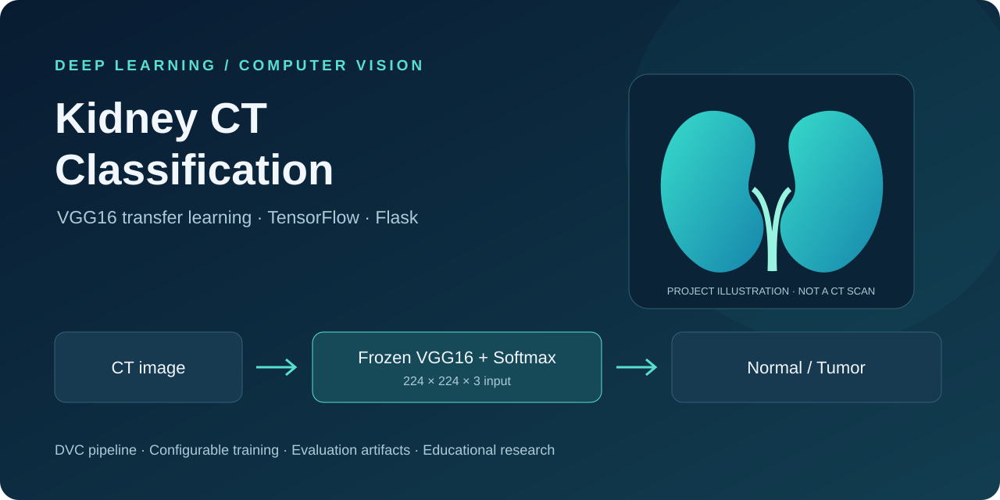
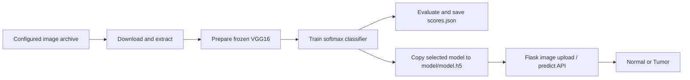

# DL · Kidney CT Classification



**A deep learning project for classifying kidney CT images as Normal or Tumor using VGG16 transfer learning, TensorFlow, Flask, and a DVC training pipeline.**

   

This repository connects data ingestion, model preparation, training, evaluation, and a browser interface in one educational workflow. It predicts an image class; it does not locate tumors, estimate disease severity, or provide a medical diagnosis. The illustration above is a project graphic, not a patient scan or a model result.

## Contents

- [Project overview](#project-overview)
- [Architecture and repository layout](#architecture-and-repository-layout)
- [Installation and web application](#installation-and-web-application)
- [Data and training](#data-and-training)
- [Model configuration](#model-configuration)
- [API](#api)
- [Recorded results and limitations](#recorded-results-and-limitations)
- [Experiment tracking and deployment](#experiment-tracking-and-deployment)
- [Contributing and license](#contributing-and-license)

## Project overview

| Area | Implementation |
| --- | --- |
| Project type | Deep learning (DL), supervised image classification |
| Input | Images resized to 224 × 224 with three channels |
| Output | Normal or Tumor label |
| Backbone | ImageNet pretrained VGG16, classifier head removed, backbone frozen |
| Classifier | Flatten layer followed by a two-unit softmax layer |
| Optimization | SGD and categorical cross-entropy |
| Web interface | Flask application with an image upload interface |
| Pipeline | Four DVC stages and a sequential Python entry point |
| Tracking | MLflow evaluation/logging implementation; remote logging is disabled in the stage entry point |
| Packaging | Installable source package, Dockerfile, and AWS workflow template |

The repository name follows **project type + project name**: `DL-Kidney-CT-Classification`. Classification describes the implemented task more precisely than a general kidney disease prediction label.

## Architecture and repository layout



```text
.
├── app.py                         # Flask routes
├── main.py                        # Run all four pipeline stages
├── config/config.yaml             # Dataset and artifact locations
├── params.yaml                    # Model and training parameters
├── dvc.yaml / dvc.lock             # Pipeline definition and recorded state
├── scores.json                    # Saved evaluation metrics
├── model/model.h5                 # Model loaded by the prediction service
├── src/cnnClassifer/
│   ├── components/                 # Ingestion, model preparation, training, evaluation
│   ├── config/                     # Configuration manager
│   ├── entity/                     # Configuration data classes
│   ├── pipeline/                   # Stage entry points and prediction
│   └── utils/                      # YAML, file, and image helpers
├── research/                       # Development notebooks
├── templates/index.html            # Browser interface
├── docs/images/project-overview.svg
├── Dockerfile
└── .github/workflows/main.yaml      # AWS ECR / self-hosted deployment template
```

`cnnClassifer` is the existing Python import directory; retain its spelling when using the code.

## Installation and web application

Use a Python 3.10 virtual environment as a starting point for the pinned TensorFlow 2.12.0 dependency. Most other dependencies are unpinned; installation and runtime compatibility need verification in your own environment.

```bash
git clone https://github.com/vams2krish/DL-Kidney-CT-Classification.git
cd DL-Kidney-CT-Classification
python -m venv .venv
```

Activate the environment:

```powershell
# Windows PowerShell
.\.venv\Scripts\Activate.ps1
```

```bash
# macOS / Linux
source .venv/bin/activate
```

Install dependencies and start the application from the repository root:

```bash
python -m pip install --upgrade pip
pip install -r requirements.txt
python app.py
```

Open **http://localhost:8080** and select a CT image in the browser interface. The model is loaded lazily on the first prediction from `model/model.h5`; the bundled file has not been independently validated by this documentation update.

## Data and training

`config/config.yaml` contains a Google Drive archive URL. The archive is downloaded and extracted by the ingestion component. Availability, dataset licensing, patient consent, provenance, and class counts are not established by the repository; verify these before obtaining or redistributing images.

Training expects this extracted layout:

```text
artifacts/data_ingestion/kidney-ct-scan-image/
├── Normal/
│   └── image files
└── Tumor/
    └── image files
```

Keras derives class indices from directory names. The prediction code assumes index `0 = Normal` and `1 = Tumor`; check the actual generator mapping before using a newly trained model.

Run either entry point:

```bash
# Sequential Python pipeline
python main.py

# Or DVC pipeline (runs stages when tracked dependencies change)
dvc repro
```

The four stages download/extract the archive, prepare VGG16, train the classifier, and evaluate it. Training rescales image values by `1/255`, uses a 30% directory validation split, and optionally applies rotations, shifts, flips, shear, and zoom.

The training artifact and serving model use different paths. To serve a selected training output, copy it explicitly:

```powershell
# Windows PowerShell; replaces the serving model
Copy-Item artifacts/training/model.h5 model/model.h5
```

```bash
# macOS / Linux; replaces the serving model
cp artifacts/training/model.h5 model/model.h5
```

Restart the app after replacing a model because prediction caches the loaded model in memory.

## Model configuration

Values currently committed in `params.yaml`:

| Parameter | Value | Purpose |
| --- | --- | --- |
| `IMAGE_SIZE` | `[224, 224, 3]` | Input shape |
| `WEIGHTS` | `imagenet` | Backbone initialization |
| `INCLUDE_TOP` | `False` | Replace the original classifier |
| `CLASSES` | `2` | Output classes |
| `BATCH_SIZE` | `16` | Training batch size |
| `EPOCHS` | `10` | Training duration |
| `LEARNING_RATE` | `0.01` | SGD learning rate |
| `AUGMENTATION` | `True` | Enable training augmentation |

Artifact locations are configured in `config/config.yaml`. Evaluation currently hardcodes its model and data locations in `ConfigurationManager.get_evaluation_config()`.

## API

| Method | Route | Behavior |
| --- | --- | --- |
| GET | `/` | Render the upload interface |
| POST | `/predict` | Decode the JSON `image` field and return a class label |
| GET / POST | `/train` | Invoke `dvc repro` synchronously |

Prediction example using Python:

```python
import base64
import json
from pathlib import Path
from urllib.request import Request, urlopen

encoded = base64.b64encode(Path('sample.jpg').read_bytes()).decode('ascii')
request = Request(
    'http://localhost:8080/predict',
    data=json.dumps({'image': encoded}).encode('utf-8'),
    headers={'Content-Type': 'application/json'},
    method='POST',
)
with urlopen(request) as response:
    print(json.load(response))
```

Example response shape (illustrative, not a verified prediction):

```json
[{"image": "Normal"}]
```

Missing image data returns HTTP 400. Some prediction failures are returned inside an array with an `error` field and may still have HTTP 200; callers should inspect the response body. The API returns labels rather than calibrated probabilities.

## Recorded results and limitations

The committed `scores.json` records:

| Metric | Saved value |
| --- | ---: |
| Accuracy | 0.4820143878 (48.20%) |
| Loss | 22.6301078796 |

These are historical saved values, not a new run, and are not established as the performance of the bundled serving model. The file does not identify dataset size, class balance, patient split, or an independent test cohort. It does not support claims of diagnostic accuracy or clinical readiness.

Known implementation limits:

- **Preprocessing mismatch:** training and evaluation rescale pixels by `1/255`; prediction currently does not. Align preprocessing and re-evaluate before interpreting predictions.
- **Validation design:** the directory split does not establish patient-level separation. Multiple images from one patient could introduce leakage. No independent test-set results, sensitivity, specificity, ROC-AUC, or confidence intervals are included.
- **Serving behavior:** requests share `inputImage.jpg`, which can cause collisions under concurrent use. Upload validation, authentication, rate limits, and production serving configuration need work.
- **Training endpoint:** `/train` is unauthenticated and returns a success message without checking the `dvc repro` exit status. Keep this development service local.
- **Reproducibility:** several dependencies are unpinned; DVC only tracks the dependencies declared in `dvc.yaml`. Helper changes may require a forced stage run or dependency updates.
- **Verification:** this documentation update does not retrain the model or establish that the application, Docker image, or AWS deployment works end to end. The workflow's lint/test steps currently only print placeholder messages.

This is an educational and research project. Do not use its output for clinical decisions.

## Experiment tracking and deployment

### MLflow

`model_evaluation_mlflow.py` implements metric, parameter, and model logging. The evaluation stage currently comments out `evaluation.log_into_mlflow()`. The configuration references an upstream DagsHub MLflow registry URI; replace it with a tracking setup you control and configure credentials outside source control before enabling logging. A registry URI alone does not configure the tracking server; review both tracking and registry settings.

For a local tracking UI, after installing dependencies:

```bash
mlflow ui
```

### Docker

The existing Dockerfile uses `python:3.8-slim-buster`, installs AWS CLI and the Python requirements, and exposes port 8080. It is a legacy starting point; its base image and dependency installation have not been validated here. Review and update it before deployment.

```bash
docker build -t kidney-ct-classifier .
docker run --rm -p 8080:8080 kidney-ct-classifier
```

### AWS workflow

`.github/workflows/main.yaml` defines ECR image publishing and a self-hosted deployment job. It expects repository secrets named `AWS_ACCESS_KEY_ID`, `AWS_SECRET_ACCESS_KEY`, `AWS_REGION`, `ECR_REPOSITORY_NAME`, and `AWS_ECR_LOGIN_URI`, plus a configured self-hosted runner. It is a deployment template, not evidence of a running service. Review its credentials, runner, container lifecycle, and placeholder validation steps before enabling it for your infrastructure.

## Contributing and license

Useful next improvements include consistent preprocessing, patient-level train/validation/test splits, class mapping persistence, meaningful automated tests, secure uploads, and updated packaging and deployment dependencies. Open an issue describing a proposed change and include reproducible validation with a pull request.

The source code is distributed under the [MIT License](LICENSE), copyright 2024 vams2krish. Dataset and pretrained-weight rights must be checked separately. The existing DagsHub configuration references the upstream `entbappy/Kidney-Disease-Classification-MLflow-DVC` project; review upstream attribution and data terms when reusing its resources.
