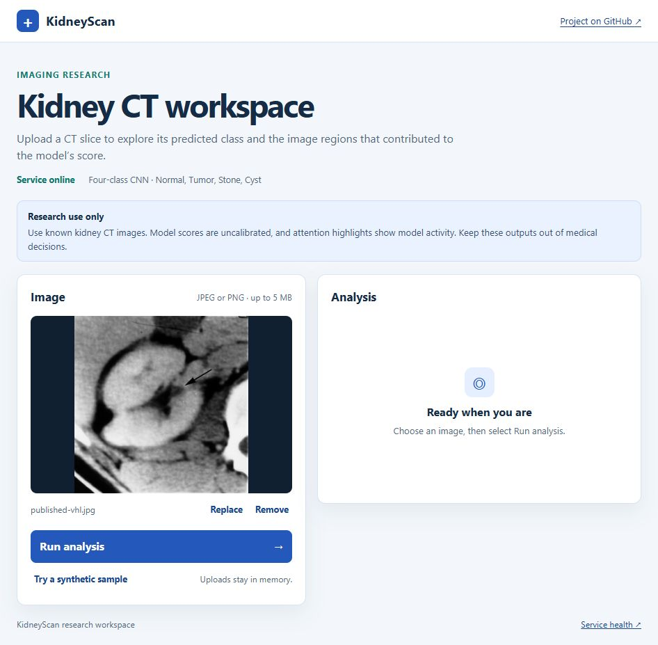
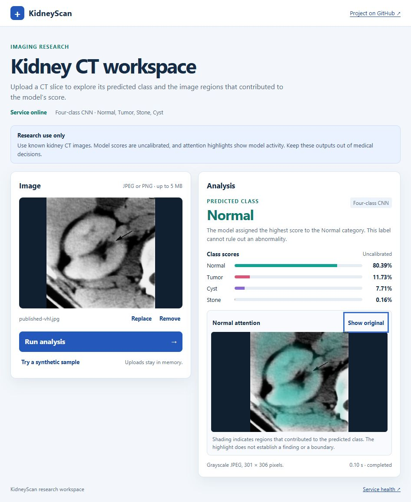
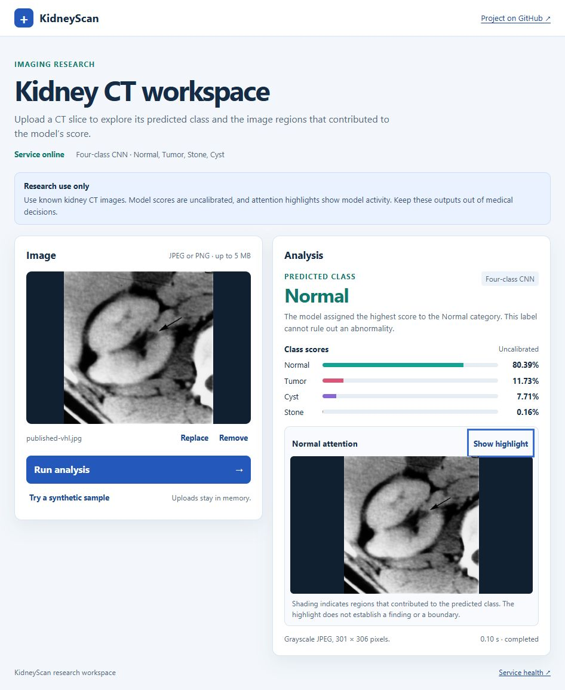
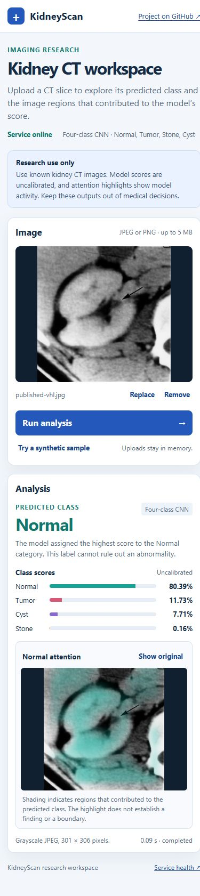
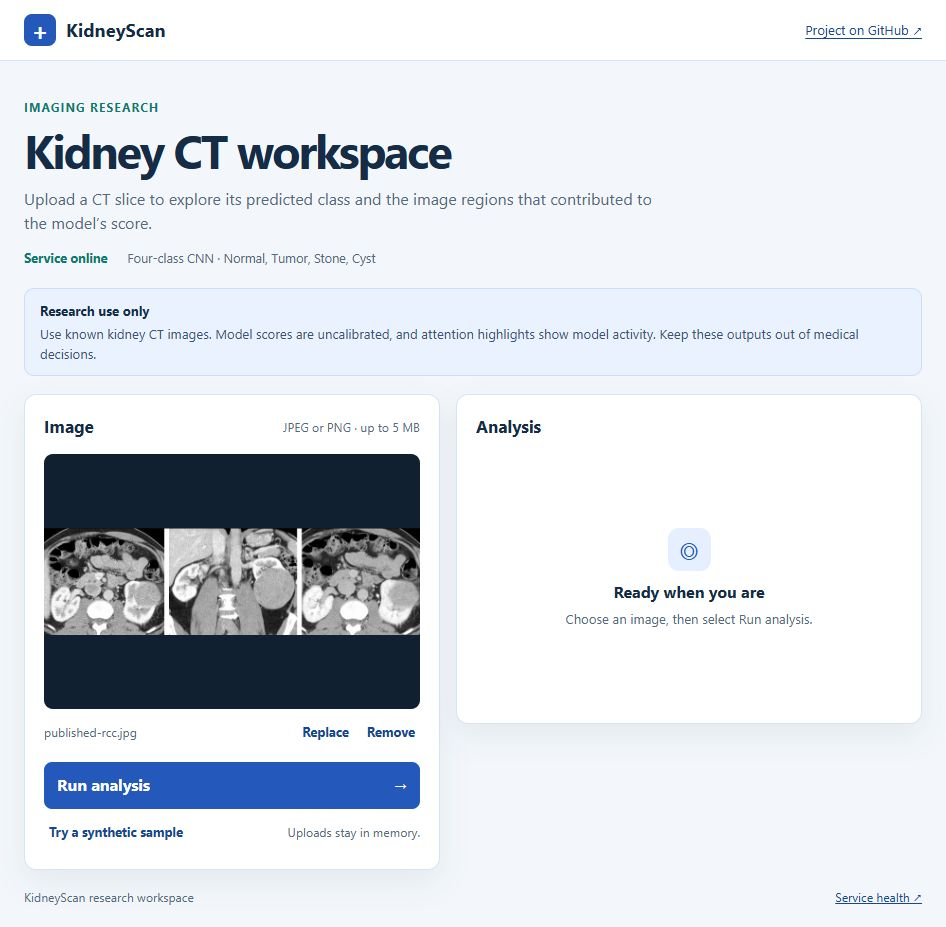
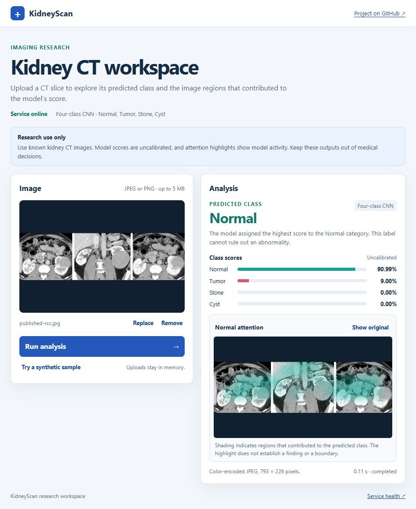

# KidneyScan · Kidney CT research workspace

KidneyScan is a local Flask app for exploring how image classifiers score a kidney CT slice. Upload a JPEG or PNG to see the predicted class, ranked raw scores, image details, and a model-attention overlay when available.

The workspace uses a **four-class CNN** for Normal, Tumor, Stone, and Cyst when its checkpoint is present. With the bundled VGG16 checkpoint, it supports **Normal and Tumor**. Both use the same upload and result workflow.

**Research use only.** Scores are uncalibrated. The app accepts ordinary image files and cannot verify that an upload is a CT scan. Attention shading shows model activity. Keep the predictions and highlights out of medical decisions.

[Run locally](#run-locally) · [Product gallery](#product-gallery) · [Model evaluation](#model-evaluation) · [Train a model](#train-a-model) · [API](#api)

## Product gallery

Every screenshot below comes from the running four-class workspace with a **real published CT image**. The screenshots demonstrate the interface. In both examples, the model predicted Normal on an image published as renal carcinoma. The class scores and overlays show what the model returned, including those errors.

### Example 1 · NIH Clinical Center CT

**Image selection and preview**



**Class scores and attention**



The model displayed **Normal** with a raw score of **80.39%**. The teal overlay corresponds to the predicted Normal class. The app’s image description reported a **301 × 306 grayscale JPEG**.

**Original image comparison**



**Mobile result**



Source: NIH Clinical Center, serial CT example of renal cell carcinoma in von Hippel–Lindau disease. Wikimedia Commons identifies the source image as U.S. public domain. The attention view adds model-generated shading. [Image and attribution](https://commons.wikimedia.org/wiki/File:CT_VHL_renal.jpg).

### Example 2 · Published multiphase renal CT

**Multiphase image preview**



**Multiphase image analysis**



The model displayed **Normal** with a raw score of **90.99%** for the **793 × 226 JPEG**. This publication figure contains multiple panels, so it also illustrates the limits of feeding a composite image to a single-slice classifier.

Source: Kristie Guite, Louis Hinshaw, and Fred Lee, *Computed Tomography in Abdominal Imaging: How to Gain Maximum Diagnostic Information at the Lowest Radiation Dose*. The published image is licensed [CC BY 3.0](https://creativecommons.org/licenses/by/3.0/). The app adds attention shading in the second screenshot. [Image and attribution](https://commons.wikimedia.org/wiki/File:Corticomedullary_phase_CT_in_axial_and_coronal_plane,_and_parenchymal_phase,_of_renal_cell_carcinoma.jpg).

## Run locally

Use Python **3.11**. From the repository root:

```powershell
git clone https://github.com/vams2krish/DL-Kidney-CT-Classification.git
cd DL-Kidney-CT-Classification
python -m venv .venv
.\.venv\Scripts\Activate.ps1
python -m pip install -r requirements-demo.txt
python serve.py
```

On macOS or Linux, activate the environment with `source .venv/bin/activate` before installing dependencies. Open [http://127.0.0.1:8080](http://127.0.0.1:8080), choose an image, and select **Run analysis**. The first request loads the model.

| Local setup | Model used by the workspace |
| --- | --- |
| Fresh clone | Bundled VGG16, Normal and Tumor |
| Compatible checkpoint at `artifacts/four-class-ct-cnn.keras` | Four-class CNN, Normal, Tumor, Stone, and Cyst |
| Custom checkpoint path | Set `KIDNEY_FOUR_CLASS_MODEL_PATH` or `KIDNEY_MODEL_PATH` before starting the server |

The app validates JPEG and PNG uploads, limits decoded files to 5 MB and 16 megapixels, and processes images in memory. The UI shows the active model. **Show original** toggles between the uploaded image and the highlight, while leaving the classification visible.

The server binds to loopback by default. See the [local walkthrough](docs/DEMO.md) for setup and troubleshooting.

## Model evaluation

### Four-class CNN

The four-class checkpoint reached **69.9% accuracy (1,649/2,360)** and **63.2% macro F1** on held-out filename blocks. The majority-class baseline was **41.4%**. Model selection used validation loss before scoring the test blocks.

| Dataset label | Correct / tested | Recall |
| --- | ---: | ---: |
| Normal | 722 / 978 | 73.8% |
| Tumor | 391 / 450 | 86.9% |
| Stone | 87 / 265 | 32.8% |
| Cyst | 449 / 667 | 67.3% |

The largest errors were Normal → Tumor (184 images) and Stone → Cyst (156 images). Exact duplicates after resizing were removed and boundary slices were excluded. Verified patient identifiers were unavailable, so related slices may still cross splits. [Full evaluation and confusion matrix](docs/four-class-evaluation.json).

### Binary experiments

| Evaluation | Result | Scope |
| --- | ---: | --- |
| Historical VGG16 validation | 48.2% | Recorded in `scores.json`. The artifact used in that run could not be tied conclusively to the bundled checkpoint. |
| Bundled VGG16 on 93 held-out images | 67/93 (72.0%) | Baseline for the retrained head comparison |
| Retrained VGG16 head on the same 93 images | 93/93 (100%) | Image-level split with exact duplicate grouping |
| Expanded-data binary CNN | 461/465 (99.1%) | Five reused filename-block folds after pretraining on 900 screened images |

The binary CNN score covers two labels on a different benchmark. The four-class app uses the separately trained four-class checkpoint. Performance on unseen patients remains unmeasured.

## Train a model

Place the extracted datasets under the local `datasets/` directory. Git ignores this directory and training artifacts.

| Folder | Contents and role |
| --- | --- |
| `datasets/CTKidney/` | The original 12,446-image archive. Folders: `normal_kidney`, `kidney_tumor`, `kidney_stone`, `cyst_kidney`. |
| `datasets/Project-Kidney-CT/` | The original 465 Normal and Tumor images for the binary benchmark. |
| `datasets/RenSeg-KidneyCT/` | Annotated collection kept separate. Its files overlap with the project data. |

[CT Kidney dataset source](https://www.kaggle.com/datasets/nazmul0087/ct-kidney-dataset-normal-cyst-tumor-and-stone) · [RenSeg-KidneyCT source](https://data.mendeley.com/datasets/rxfk6t8f6x/2)

Activate the serving environment, then install scikit-learn and run one of the training commands:

```powershell
python -m pip install scikit-learn

# Four-class checkpoint and held-out evaluation
python tools/train_four_class_cnn.py --dataset datasets/CTKidney

# Binary research CNN with screened pretraining images
python tools/retrain_expanded_cnn.py --export artifacts/expanded-ct-cnn-folder.keras

# Binary VGG16 classifier head on the original project dataset
python tools/retrain_vgg16.py
```

Four-class training saves `artifacts/four-class-ct-cnn.keras` and `artifacts/four-class-evaluation.json`. Both expanded training scripts also accept `--archive /path/to/CTKidney.zip`. Restart the server to pick up a new four-class checkpoint. The expanded-data binary CNN is a separate research artifact with a different input and output shape than the bundled VGG16 model.

To run four-class inference directly in Python:

```python
import numpy as np
from PIL import Image, ImageOps
from tensorflow.keras.models import load_model

labels = ("Normal", "Tumor", "Stone", "Cyst")
model = load_model("artifacts/four-class-ct-cnn.keras", compile=False)

with Image.open("sample.jpg") as image:
    gray = ImageOps.exif_transpose(image).convert("L")
    prepared = ImageOps.pad(gray, (64, 64), Image.Resampling.BILINEAR, color=0)

scores = model(np.asarray(prepared)[None, ..., None], training=False).numpy()[0]
print(labels[scores.argmax()], dict(zip(labels, scores.tolist())))
```

The original DVC pipeline remains available with the separate training dependencies in `requirements.txt`. It reads `config/config.yaml` and `params.yaml`, writes its model to `artifacts/training/model.h5`, and saves evaluation metrics to `scores.json`. MLflow logging is optional.

## API

| Method | Endpoint | Purpose |
| --- | --- | --- |
| GET | `/` | Research workspace |
| GET | `/health` | Server health and binary model load status |
| GET | `/ready` | Check bundled or configured binary checkpoint readiness |
| POST | `/predict` | Classify an image passed as base64 in JSON |
| GET / POST | `/train` | Returns 403. Run training from the command line. |

```json
{
  "image": "<base64 JPEG or PNG>",
  "mode": "auto",
  "explain": true
}
```

`auto` uses the four-class checkpoint when installed. Use `four_class` or `binary` to select explicitly. Omitting `mode` preserves the binary response. Success returns an array with the winning label in `image`, its score in `score`, all class scores in `scores`, and the serving model in `model`. With explanations enabled, the response also includes `description` and may include `attention_class` plus a base64 PNG in `attention_image`.

Four-class highlights use Grad-CAM for the predicted class with input padding removed before alignment. The colors are teal for Normal, rose for Tumor, amber for Stone, and violet for Cyst. Binary VGG16 can return a Tumor-class highlight when positive evidence is available. The overlays have no verified lesion boundaries.

## Verification and deployment

```powershell
python -m pip install -r requirements-dev.txt
python -m pytest -q
```

GitHub Actions runs the test suite and a live HTTP check. The Dockerfile packages the serving environment. The AWS workflow is manual and requires infrastructure configuration. [Verification record](docs/VERIFICATION.md) · [GitHub Actions](https://github.com/vams2krish/DL-Kidney-CT-Classification/actions)

## License

Project source code is under the [MIT License](LICENSE). Dataset, checkpoint, and screenshot source terms should be reviewed separately. The two published CT examples are attributed in the gallery above.
